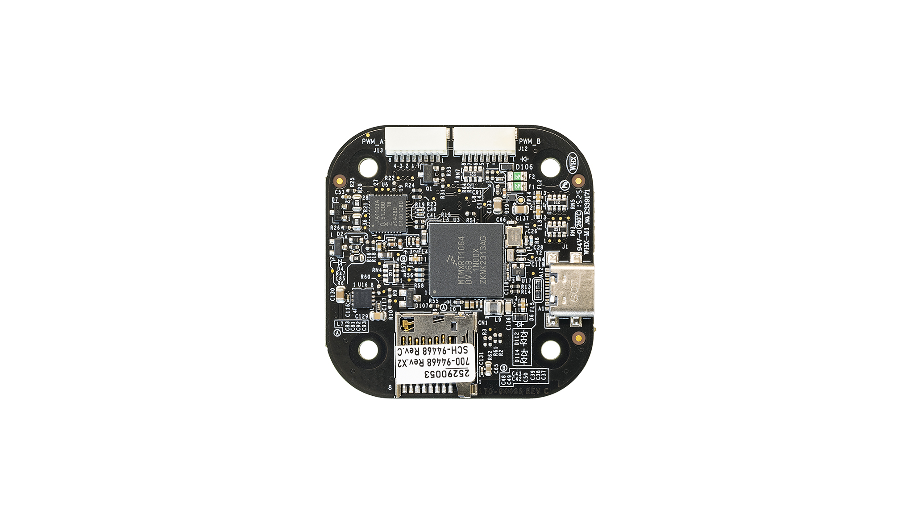

## Processors & Sensors

- FMU Processor: NXP i.MX RT1064
  - 32 Bit Arm Cortex-M7, 600MHz
  - On-chip 4MB flash
  - 1 MB on-chip SRAM - up to 512 KB configurable as tightly coupled memory (TCM)

- On-board sensors:
  - Accel/Gyro: TDK InvenSense ICM-45686
  - Accel/Gyro: Bosch BMI088
  - Mag: Bosch BMM350
  - Pressure Sensor: Bosch BMP390

## Electrical Data

- Voltage Ratings:
  - Max input voltage: 5.5V
  - USB Power Input: 5V
  - Servo Rail Input: TODO

- Current Ratings: TODO

## Mechanical Data (dimensions & weight)

- Dimensions:
  - Standard Baseboard: 46 x 45 x 1.57mm
- Weight:
  - Standard Baseboard: TODO

## Assembly/Setup

Wiring is similar to the [Holybro Pixhawk 6X](../flight_controller/pixhawk6x.md#connections) and other boards that follow the [Pixhawk Connector Standard](https://github.com/pixhawk/Pixhawk-Standards/blob/master/DS-009%20Pixhawk%20Connector%20Standard.pdf).

## Connections

_MR-VMU-TROPIC_ connectors (following [Pixhawk Connector Standard](https://github.com/pixhawk/Pixhawk-Standards/blob/master/DS-009%20Pixhawk%20Connector%20Standard.pdf))
TODO images





The NXP reference board design production version units have a slightly different connector set than what has tradionally been included in the standard V6X design and also the Holybro V6X-RT units.

The key differentiators are:
-  No separate IO processor required. All PWMs including redundant coming from RT1064

* CAN port
* 100BaseT1 two wire ethernet

### Top side interface

* USB-C interface
* PWM_A and PWM_B

TODO image

### Back side interface

* RC receiver connector
* Primary GPS port
* Auxiliary UART connector
* Telemetry Port 1
* Telemetry Port 2
* Debug interface compliant to Pixhawk-DEBUG-FULL standard (aka DCD-F), including SWD and Console access.
* T1-ETH: 100BaseT1 Two wire 100MBPS Ethernet 
* CAN: Dual CAN-FD interfaces employing CAN-SIC (Signal Improvement) CAN phys
* OSD: SPI expansion connector
* Power input

TODO image

### Debugger and serial console connection
TODO image

### Indicator LEDs
TODO image

## Pinouts

### Top view TODO


### Back view TODO


### Left side view TODO


### Right side view TODO


## Building Firmware
> Most users will not need to build this firmware!
It is pre-built and automatically installed by _QGroundControl_ when appropriate hardware is connected.


To [build PX4](https://docs.px4.io/main/en/dev_setup/building_px4) for this target:

```sh
make nxp_mr-tropic_default
```

## Debug Port

The [PX4 System Console](https://docs.px4.io/main/en/debug/system_console) and [SWD interface](https://docs.px4.io/main/en/debug/swd_debug) run on the FMU Debug port.

The pinouts and connector comply with the [Pixhawk Debug Full](https://docs.px4.io/main/en/debug/swd_debug#pixhawk-debug-full) interface defined in the [Pixhawk Connector Standard](https://github.com/pixhawk/Pixhawk-Standards/blob/master/DS-009%20Pixhawk%20Connector%20Standard.pdf) interface (J3 JST SM10B connector).

| Pin      | Signal           | Volt  |
| -------- | ---------------- | ----- |
| 1 (red)  | `Vtref`          | +3.3V |
| 2 (blk)  | Console TX (OUT) | +3.3V |
| 3 (blk)  | Console RX (IN)  | +3.3V |
| 4 (blk)  | `SWDIO`          | +3.3V |
| 5 (blk)  | `SWCLK`          | +3.3V |
| 6 (blk)  | `SWO`            | +3.3V |
| 7 (blk)  | NC               |   -   |
| 8 (blk)  | NC               |   -   |
| 9 (blk)  | nRST             | +3.3V |
| 10 (blk) | `GND`            | GND   |

For information about using this port see:

- [SWD Debug Port](../debug/swd_debug.md)
- [PX4 System Console](../debug/system_console.md)


## Interfaces

- 8 PWM servo outputs, all 8 with D-SHOT
- Dedicated R/C input for CRSF / ELRS
- 3 general purpose serial ports:
  - 3 with full flow control
- 1 GPS port
  - 1 full GPS plus Safety Switch Port
- 1 I2C port
- 1 Ethernet port
  - Transformerless Applications
  - 100Mbps
- 1 SPI bus (OSD)
  - 1 chip select line
  - 1 data-ready line
  - 1 reset line
- 1 CAN Bus for CAN peripheral
  - Termination resistor on-board (120 ohm)
- 1 Power input port with SMBus
- 1 Debug port

- Other Characteristics:
  - Operating & storage temperature: {TODO}°c
